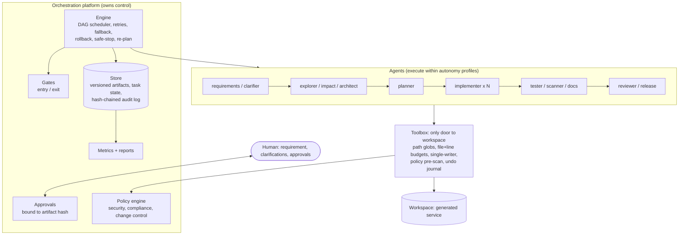
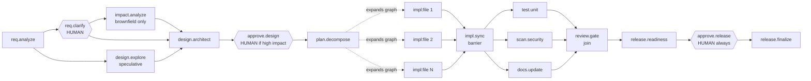
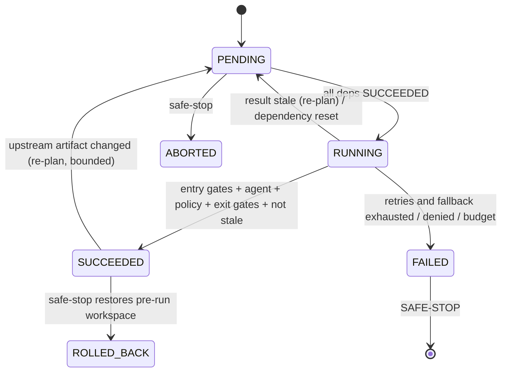

# Architecture

## 1. Big picture



Two rules shape everything:

1. **Agents propose, the platform disposes.** An agent is a pure `run(ctx) -> AgentResult`. It cannot write files, run
   processes, approve itself or skip a gate except through the `Toolbox`/engine, which enforce limits *outside* the agent.
2. **Everything is an event.** State transitions, gate results, policy blocks, approvals, artifact versions and decisions go to an
   append-only, hash-chained log. Metrics, lineage and the final report are *derived* from it, so they can be re-computed and audited.

## 2. The workflow graph (explicit, with gates, parallelism and sync points)



* **Non-linear:** `design.explore` runs concurrently with the human clarification; validation (`test`, `scan`, `docs`) runs as
  three parallel branches that re-join at `review.gate`.
* **Dynamic:** `plan.decompose` *expands the live graph* with one `impl:<file>` task per file, wired by the **import graph of the code being
  produced** (leaf modules first, `api.py` after `service.py`, tests last), and rewires the `impl.sync` barrier to wait for them. An expansion that
  would create a cycle is rejected before it is committed (tested).
* **Gates** (`gates.py`) are named predicates on tasks: *entry* (`spec_resolved`, `design_approved`, `tests_green_in`, `release_approved`) and
  *exit* (`acceptance_criteria`, `design_complete`, `plan_valid`, `unit_tests_green`, `scan_clean`, `review_passed`). A failed gate is an
  event and a task failure, never a warning.

## 3. Task lifecycle and control flow



Inside one task (worker thread), per variant (primary agent, then fallback agent):

```
entry gates -> agent.run -> exit gates
   TransientError    -> rollback own writes, backoff, retry (<= max_retries)
   PolicyViolation   -> rollback, NO retry (deterministic) -> fallback agent
   AgentError/Gate   -> rollback -> fallback agent
   ApprovalDenied / SafeStop -> fatal, no fallback
all variants failed -> TASK_FAILED -> engine SAFE-STOP
```

The **coordinator thread** (single-threaded) owns all state transitions, so parallel workers cannot corrupt the graph.

### Safe-stop and rollback
Triggers: task failure, denied approval, attempt budget, wall-clock budget, replan budget, kill-switch file. Effect: no new tasks start; in-flight
tasks finish their current attempt; `PENDING` tasks become `ABORTED`; with `rollback_on_halt` (default) every completed task is undone **in reverse
completion order** from its undo journal, leaving the workspace byte-identical to the pre-run state (asserted by `test_permanent_failure_restores_workspace_exactly`).

### Re-planning
Every artifact read is recorded (`task -> {artifact: version}`). When a task publishes a *new version* of an artifact, `SUCCEEDED` consumers are
rolled back and reset together with their transitive dependants; in-flight consumers are caught by a staleness check when they complete (inputs or
dependencies changed) and their result is discarded. Each task may be re-planned at most `max_replans_per_task` times, otherwise the run safe-stops
(tested with two agents that feed each other forever). Approvals are bound to `sha256(artifact)`, so a changed design invalidates its approval.

## 4. Governance

| Concern | Mechanism | Where |
|---|---|---|
| Autonomy boundary | `AutonomyProfile`: write globs, max files, max changed lines, may run tests / export schema | `models.py`, `toolbox.py` |
| Security | SEC-001 secrets, SEC-002 `eval/exec/os.system/shell=True`, SEC-003 SQL string building, SEC-004 required controls (scheme allow-list, SSRF guard), SEC-005 path escape | `policy.py` |
| Compliance | CMP-001 raw IP/user-agent/email persisted; CMP-002 human answer demanding raw PII | `policy.py`, `agents/requirements.py` |
| Change control | CHG-001 protected paths, CHG-002 code without tests, CHG-003 diff budget, CHG-004 concurrent writer, CHG-005 outside boundary, CHG-006 unparsable code | `policy.py`, `toolbox.py` |
| Human approval | design (mandatory if schema/API/PII impact, otherwise policy auto-approval *that is logged*), release (always); bound to content hash | `agents/governance.py` |
| Audit | sha256 hash-chained events; `verify` detects edits and deletions | `store.py` |
| Traceability | `lineage <run> <artifact>`: task, input artifact versions, recursively | `reports.py` |
| Reliability KPIs | success rate, first-pass rate, retries, fallbacks, replans, rollbacks, safe-stops, approvals, MTTR, latency (total / human / automation) | `metrics.py` |

Policy checks happen **before bytes are written** (`Toolbox.write`), again on the final workspace (`scanner`), and again as change-control rules in
the `reviewer`. Defence in depth, because each layer has a different failure mode.

## 5. Key design decisions

| Decision | Why | Trade-off |
|---|---|---|
| Deterministic, catalog-driven agents; LLM only as an optional, validated, fall-back-able seam | Reproducible runs, testable guardrails, no keys/network in CI; the *orchestration* is the product | The implementer cannot synthesise arbitrary code; scope = what the catalog knows |
| Engine owns state; agents are pure functions of a context | Retry/rollback/replan are only safe if agent work is replayable | Agents cannot keep private memory between attempts |
| Structured anchor-based edits for brownfield (exact-once match) | A mismatch means the codebase drifted from what was reviewed; failing loudly beats a silent bad patch | Edits are brittle to refactors (by design: triggers rollback + human) |
| Undo journals instead of VCS snapshots | Exact per-task rollback, works while branches run in parallel | Only covers workspace files, not external side effects (there are none) |
| Hash-chained SQLite log instead of plain logging | Tamper evidence + queryable lineage/metrics with no extra infra | Not a distributed ledger; an attacker with DB + code access can rewrite the whole chain (anchor the head hash externally in production) |
| Speculative `design.explore` in parallel with humans | Shows non-linear flow and bounded re-planning; hides human latency | Wasted work when the spec changes |
| Approval denial = safe-stop | Simple and safe | No feedback loop into redesign yet |
| Thread pool in one process | Simple, observable, deterministic enough | Not horizontally scalable; a real deployment would put tasks on a queue |

## 6. Assignment requirement → implementation map

| Requirement | Delivered by |
|---|---|
| Requirement understanding (intent, ambiguity, normalisation) | `agents/requirements.py` (spec with functional/NFR/assumptions/out-of-scope/ambiguities), clarifier |
| Task decomposition with dependencies and sequencing | `agents/design.py::PlannerAgent` (import-graph ordering, parallel levels), `pipeline.build_tasks` |
| Codebase reasoning (brownfield) | `agents/design.py::ImpactAgent` (AST import graph, routes, tables, transitive regression surface, already-implemented detection) |
| Workflow orchestration: explicit DAG, entry/exit gates, parallel + sync | `graph.py`, `engine.py`, `gates.py`, `pipeline.py` |
| Cross-stage context and decision lineage | `store.py` (versioned artifacts), `TaskContext.read` recording, `reports.lineage` |
| Human approval checkpoints | `agents/governance.py::ApprovalGateAgent`, `approvals.py` |
| Bounded retries, fallback, rollback, safe-stop | `engine._execute`, `_finish`, `toolbox.rollback`, `EngineConfig` budgets |
| Policy guardrails (security, compliance, change control) | `policy.py`, `toolbox.py` |
| Audit-grade observability | hash-chained events, `trace`, `verify`, `lineage` |
| Reliability metrics (success, retry/rollback frequency, MTTR, latency) | `metrics.py` |
| Dynamic re-planning under governance | `engine._invalidate_consumers/_reset` (bounded; approvals re-bound) |
| Production-quality output (code, schemas, tests, docs) | `catalog/` + generated workspace: FastAPI service, OpenAPI JSON, 34–47 tests, README, CHANGELOG, design log |
| Validation and risk control | tester, scanner, reviewer, release checklist; risks + mitigations in every design |
| Controlled autonomy | `AutonomyProfile` enforced by `Toolbox`; humans approve design/release and answer blocking questions |
| Final engineering summary | `reports.engineering_summary` → `ENGINEERING_SUMMARY.md` per run; `docs/FINAL_SUMMARY.md` for the project |
