# Engineering summary - run `ambiguous-013418-ad15`

**Scenario:** ambiguous  |  **Status:** COMPLETED  |  agentic-url-shortener/runs/ambiguous-013418-ad15/workspace`

> Make links temporary and let us know who is clicking them, and keep it fast.

## 1. Requirement understanding

Mode: **brownfield**. Capabilities: expiry, unique_visitors.

| ID | Requirement | Acceptance criteria |
|---|---|---|
| F-EXP | Links may carry an optional TTL; expired links stop redirecting | ttl_seconds in [60, 31536000] yields expires_at = created_at + ttl; redirect after expiry returns 410 and records no click; ttl outside the range returns 422; databases created before this release keep working (idempotent migration) |
| F-UV | Report distinct visitors per link without storing personal data | stats include unique_visitors; repeat visits by the same client on the same day count once; no raw IP address or user-agent is persisted |

**Ambiguities and how they were closed**

- `AMB-1` (functional, non-blocking): How long may a temporary link live (allowed range), and who chooses the lifetime?  
  -> assumed-default: Optional per-link ttl_seconds (60 s to 365 d); links without a ttl never expire
- `AMB-2` (compliance, blocking): 'Know who is clicking' - do you need to identify individuals (personal data) or only count distinct visitors? What retention period and legal basis apply?  
  -> human: Count distinct visitors per link only - no identification of individuals. Use salted hashes and never store raw IP addresses or user-agents; aggregate counts only.
- `AMB-3` (nfr, non-blocking): 'fast' is not measurable. What latency / throughput / availability targets apply?  
  -> assumed-default: p95 redirect < 100 ms at 100 req/s on one node; 99.9% availability; OWASP ASVS L1 controls

**Assumptions**

- Single-node deployment with SQLite is acceptable for the prototype
- 302 (not 301) redirects so every click is observable and links stay revocable
- AMB-1: Optional per-link ttl_seconds (60 s to 365 d); links without a ttl never expire (assumed; no answer given)
- AMB-3: p95 redirect < 100 ms at 100 req/s on one node; 99.9% availability; OWASP ASVS L1 controls (assumed; no answer given)

**Out of scope**

- Authentication / per-user link ownership
- Multi-region replication
- Link deletion UI

## 2. Codebase impact (brownfield)

Risk: **high** - schema change on existing data

| Module | Why |
|---|---|
| `shortener/api.py` | expiry: change set edits this module; unique_visitors: change set edits this module |
| `shortener/repository.py` | expiry: change set edits this module; unique_visitors: change set edits this module |
| `shortener/service.py` | expiry: change set edits this module; unique_visitors: change set edits this module |
| `shortener/validation.py` | expiry: change set edits this module |
| `tests/test_api.py` (transitive) | imports shortener/api.py - regression surface |
| `tests/test_service.py` (transitive) | imports shortener/repository.py, shortener/service.py - regression surface |
| `tests/test_validation.py` (transitive) | imports shortener/validation.py - regression surface |

Routes touched: /healthz, /api/v1/urls, /api/v1/urls/{code}/stats, /{code}  
Tables: {"shortener/repository.py": ["links", "clicks"]}  
Existing tests re-run: tests/test_api.py, tests/test_service.py, tests/test_validation.py

## 3. Task decomposition and orchestration

Source units are ordered by the import graph of the produced code; test units wait for all source units so they are authored against the final contract. Units within a level run in parallel.

| Level | Work units (run in parallel) |
|---|---|
| 0 | `impl:shortener/privacy.py`, `impl:shortener/repository.py`, `impl:shortener/validation.py` |
| 1 | `impl:shortener/service.py` |
| 2 | `impl:shortener/api.py` |
| 3 | `impl:tests/test_expiry.py`, `impl:tests/test_unique_visitors.py` |

```mermaid
flowchart LR
  req_analyze["req.analyze"]
  req_clarify{{"req.clarify"}}
  design_explore["design.explore"]
  impact_analyze["impact.analyze"]
  design_architect["design.architect"]
  approve_design{{"approve.design"}}
  plan_decompose["plan.decompose"]
  impl_sync["impl.sync"]
  test_unit["test.unit"]
  scan_security["scan.security"]
  docs_update["docs.update"]
  review_gate["review.gate"]
  release_readiness["release.readiness"]
  approve_release{{"approve.release"}}
  release_finalize["release.finalize"]
  impl_shortener_api_py["impl:shortener/api.py"]
  impl_shortener_privacy_py["impl:shortener/privacy.py"]
  impl_shortener_repository_py["impl:shortener/repository.py"]
  impl_shortener_service_py["impl:shortener/service.py"]
  impl_shortener_validation_py["impl:shortener/validation.py"]
  impl_tests_test_expiry_py["impl:tests/test_expiry.py"]
  impl_tests_test_unique_visitors_py["impl:tests/test_unique_visitors.py"]
  req_analyze --> req_clarify
  req_analyze --> design_explore
  req_clarify --> impact_analyze
  req_clarify --> design_architect
  design_explore --> design_architect
  impact_analyze --> design_architect
  design_architect --> approve_design
  approve_design --> plan_decompose
  impl_shortener_api_py --> impl_sync
  impl_shortener_privacy_py --> impl_sync
  impl_shortener_repository_py --> impl_sync
  impl_shortener_service_py --> impl_sync
  impl_shortener_validation_py --> impl_sync
  impl_tests_test_expiry_py --> impl_sync
  impl_tests_test_unique_visitors_py --> impl_sync
  plan_decompose --> impl_sync
  impl_sync --> test_unit
  impl_sync --> scan_security
  impl_sync --> docs_update
  test_unit --> review_gate
  scan_security --> review_gate
  docs_update --> review_gate
  review_gate --> release_readiness
  release_readiness --> approve_release
  approve_release --> release_finalize
  plan_decompose --> impl_shortener_api_py
  impl_shortener_privacy_py --> impl_shortener_api_py
  impl_shortener_repository_py --> impl_shortener_api_py
  impl_shortener_service_py --> impl_shortener_api_py
  impl_shortener_validation_py --> impl_shortener_api_py
  plan_decompose --> impl_shortener_privacy_py
  plan_decompose --> impl_shortener_repository_py
  plan_decompose --> impl_shortener_service_py
  impl_shortener_repository_py --> impl_shortener_service_py
  impl_shortener_validation_py --> impl_shortener_service_py
  plan_decompose --> impl_shortener_validation_py
  plan_decompose --> impl_tests_test_expiry_py
  impl_shortener_api_py --> impl_tests_test_expiry_py
  impl_shortener_privacy_py --> impl_tests_test_expiry_py
  impl_shortener_repository_py --> impl_tests_test_expiry_py
  impl_shortener_service_py --> impl_tests_test_expiry_py
  impl_shortener_validation_py --> impl_tests_test_expiry_py
  plan_decompose --> impl_tests_test_unique_visitors_py
  impl_shortener_api_py --> impl_tests_test_unique_visitors_py
  impl_shortener_privacy_py --> impl_tests_test_unique_visitors_py
  impl_shortener_repository_py --> impl_tests_test_unique_visitors_py
  impl_shortener_service_py --> impl_tests_test_unique_visitors_py
  impl_shortener_validation_py --> impl_tests_test_unique_visitors_py
  style approve_design fill:#d4f4dd
  style approve_release fill:#d4f4dd
  style design_architect fill:#d4f4dd
  style design_explore fill:#d4f4dd
  style docs_update fill:#d4f4dd
  style impact_analyze fill:#d4f4dd
  style impl_sync fill:#d4f4dd
  style impl_shortener_api_py fill:#d4f4dd
  style impl_shortener_privacy_py fill:#d4f4dd
  style impl_shortener_repository_py fill:#d4f4dd
  style impl_shortener_service_py fill:#d4f4dd
  style impl_shortener_validation_py fill:#d4f4dd
  style impl_tests_test_expiry_py fill:#d4f4dd
  style impl_tests_test_unique_visitors_py fill:#d4f4dd
  style plan_decompose fill:#d4f4dd
  style release_finalize fill:#d4f4dd
  style release_readiness fill:#d4f4dd
  style req_analyze fill:#d4f4dd
  style req_clarify fill:#d4f4dd
  style review_gate fill:#d4f4dd
  style scan_security fill:#d4f4dd
  style test_unit fill:#d4f4dd
```



## 4. Design decisions and trade-offs

| ID | Decision | Rationale | Alternatives rejected |
|---|---|---|---|
| D-EXP-1 | Store absolute `expires_at` (REAL, nullable) on `links` | Absolute timestamps make reads a single comparison and survive TTL policy changes | store ttl + created_at (needs arithmetic on every read); background reaper deleting rows (loses analytics, needs scheduler) |
| D-EXP-2 | Lazy expiry check at resolve time; rows are kept | No scheduler to operate; analytics history preserved; 410 is more informative than 404 | periodic purge job |
| D-EXP-3 | Additive, idempotent migration (`ALTER TABLE ... ADD COLUMN`) executed on startup | Backward compatible: existing rows get NULL (= never expires); old binaries ignore the column | offline migration tool; new table + backfill |
| D-UV-1 | Identify visitors by HMAC-SHA256 keyed with a secret salt over (day, ip, user-agent), truncated to 128 bits | Raw IP/user-agent are personal data (GDPR/CCPA); a keyed hash allows counting without re-identification | store raw IP (rejected by policy CMP-001); cookie-based ids (needs consent banner, defeats curl/bots) |
| D-UV-2 | Salt rotates daily, so uniqueness is per-day | Limits cross-day tracking (data minimisation); a leaked hash table cannot be linked across days | static salt (long-term trackable) |
| D-PRIV-1 | Personal data is hashed at the edge; raw values never reach storage or logs | Human decision recorded in spec: Count distinct visitors per link only - no identification of individuals. Use salted hashes and never store raw IP addre | raw storage (blocked, CMP-001/002) |

**API changes:** POST /api/v1/urls: optional `ttl_seconds` (60..31536000); response gains `expires_at` (nullable); GET /{code}: new 410 Gone response for expired links; GET /api/v1/urls/{code}/stats: response gains `unique_visitors` (integer)

## 5. Risks

| Risk | Likelihood | Impact | Mitigation |
|---|---|---|---|
| Schema change on a live database | low | high | Additive nullable column, idempotent migration, covered by a legacy-database test; rollback = ignore column |
| Clock skew between nodes makes links expire early/late | medium | low | Single clock source per deployment; document NTP requirement |
| Multi-day counts over-count returning visitors (different hash each day) | high | low | Documented limitation; metric is 'unique visitors per day, summed' |
| Salt lost on restart if VISITOR_SALT unset (counts reset) | medium | low | Operators set VISITOR_SALT from the secret store; startup uses a random salt otherwise |
| Hash of IPv4 space is brute-forceable if the salt leaks | low | medium | Salt is a server secret, never persisted next to the data; rotates daily in practice via VISITOR_SALT rotation |

## 6. Artifacts produced

| File | Action | + | - |
|---|---|---|---|
| `shortener/api.py` | modify | 14 | 3 |
| `shortener/privacy.py` | create | 16 | 0 |
| `shortener/repository.py` | modify | 25 | 5 |
| `shortener/service.py` | modify | 16 | 7 |
| `shortener/validation.py` | modify | 10 | 0 |
| `tests/test_expiry.py` | create | 66 | 0 |
| `tests/test_unique_visitors.py` | create | 36 | 0 |
| `README.md` | docs | | |
| `CHANGELOG.md` | docs | | |
| `docs/DESIGN.md` | docs | | |
| `docs/openapi.json` | docs | | |

## 7. Validation

- **Tests:** 47 passed, 0 failed, 0 errors (5 test files)
- **Policy scan:** 19 files, 0 violation(s); rules: SEC-001 secrets, SEC-002 dangerous calls, SEC-003 SQL injection, SEC-004 required controls, CMP-001 raw PII at rest
- **Independent review:** 0 blocker(s), 1 warning(s)
  - warning: 2 ambiguity(ies) resolved by assumption, not by a human: ['AMB-1', 'AMB-3']

## 8. Governance trail

| Approval | Mode | Approver | Decision | Reason |
|---|---|---|---|---|
| design | human | eng-lead (scripted) | APPROVED | Additive migration and API change reviewed; rollback plan acceptable |
| release | human | eng-lead (scripted) | APPROVED | Checklist green, rollout/rollback plan acceptable |

**Recorded decisions**

- `req.clarify` {"answer": "Optional per-link ttl_seconds (60 s to 365 d); links without a ttl never expire", "by": "agent", "decision": "AMB-1 defaulted"}
- `req.clarify` {"answer": "Count distinct visitors per link only - no identification of individuals. Use salted hashes and never store raw IP addresses or user-agents; aggregate counts only.", "by": "eng-lead (scripted)", "decision": "
- `req.clarify` {"answer": "p95 redirect < 100 ms at 100 req/s on one node; 99.9% availability; OWASP ASVS L1 controls", "by": "agent", "decision": "AMB-3 defaulted"}

**Re-plans**

- `design.explore` {"files_restored": 0, "reason": "upstream artifact spec changed (task req.clarify)"}

Decision lineage of the design:

```
design@v1  <- task design.architect  sha256:c174e387de5c5f80
  design_draft@v1  <- task design.explore  sha256:44d1edb9831724fc
    spec@v1  <- task req.analyze  sha256:698db4068c965500
  impact@v1  <- task impact.analyze  sha256:be42c3388bc944c1
    spec@v2  <- task req.clarify  sha256:f466cb49013abc67
      spec@v1  (expanded above)
  spec@v2  (expanded above)
```

## 9. Reliability metrics

| Metric | Value |
|---|---|
| Task success rate | 100% (22/22) |
| Completed-then-rolled-back tasks | 0% of tasks (work done, then undone by safe-stop) |
| First-pass success rate | 96% |
| Attempts / retries / fallbacks | 23 / 0 / 0 |
| Policy blocks / gate failures | 0 / 0 |
| Replans / rollbacks / safe-stops | 1 / 1 / 0 |
| Approvals requested / denied | 2 / 0 |
| MTTR | n/a (no failures recovered) |
| End-to-end latency | 1.124s (human wait 0.037s, automation 1.087s) |

## 10. Release readiness

- [x] automated tests green - 47 passed across 5 test files
- [x] policy scan clean - 19 files, 0 violation(s)
- [x] documentation regenerated - 4 endpoints in OpenAPI + README
- [x] independent review has no blockers - 7 files, +183/-15
- [x] design approval recorded - human by eng-lead (scripted)
- [x] audit log hash-chain intact - sha256 chain verified up to this point

**Rollout**

1. Deploy to staging and run the smoke tests (create -> redirect -> stats).
1. Start the new build; additive migration runs automatically at startup (idempotent).
1. Watch error rate, p95 redirect latency and /healthz for 30 minutes before full traffic.

**Rollback**

- Redeploy the previous build; no data restore required.
- Schema change is additive (new nullable column / new table): the previous build ignores it, so rollback loses no data.
- If privacy review objects: unset the feature (revert) and DROP TABLE visitors; no raw personal data exists to purge.

Recommended version bump: `minor`

## 11. Limitations of this prototype

- Agents are deterministic/rule-based; the LLM seam (orchestrator/llm.py) augments requirement analysis only and is not exercised in CI.
- The implementer applies a curated catalog of change sets; it does not synthesise arbitrary code. Unknown requirements stop at the requirements gate.
- Runs are persisted (state, artifacts, hash-chained audit log) but an interrupted run cannot be resumed; it must be restarted.
- Rollback restores the workspace via undo journals; it does not undo external side effects (none are performed by design).
- Human denial of an approval safe-stops the run; it does not (yet) route feedback back into a redesign loop.
- SQLite + in-process rate limiting + hashed visitors are single-node prototype choices; see design risks for the scale-out path.
- Test quality is measured by pass/fail and policy scans, not by mutation testing or coverage thresholds.
