# Engineering summary - run `greenfield-013416-5023`

**Scenario:** greenfield  |  **Status:** COMPLETED  |  agentic-url-shortener/runs/greenfield-013416-5023/workspace`

> Build a URL shortener service. Users create short links for long URLs, optionally with a custom alias, and are redirected with HTTP 302. Each link has click analytics (total clicks and last click time). Link creation is rate limited to 10 requests per minute per client. Expose a health endpoint. Reject non-http(s) and private-network targets.

## 1. Requirement understanding

Mode: **greenfield**. Capabilities: core.

| ID | Requirement | Acceptance criteria |
|---|---|---|
| F-1 | Create a short link for a valid http(s) URL; optionally with a custom alias | 201 with a 7-character code and short_url; non-http(s), private-network and over-long URLs return 422; alias already in use returns 409; reserved or malformed alias returns 422 |
| F-2 | Redirect a short code to its long URL | known code returns 302 with Location header; unknown code returns 404 |
| F-3 | Per-link click analytics | each redirect increments total_clicks; stats expose total_clicks and last_clicked_at; unknown link stats return 404 |
| F-4 | Rate-limit link creation to protect the service | more than 10 creations/minute/client returns 429 with Retry-After |
| F-5 | Operational health endpoint | GET /healthz returns 200 when the database answers, 503 otherwise |

**Ambiguities and how they were closed**

- none

**Assumptions**

- Single-node deployment with SQLite is acceptable for the prototype
- 302 (not 301) redirects so every click is observable and links stay revocable

**Out of scope**

- Authentication / per-user link ownership
- Multi-region replication
- Link deletion UI

## 3. Task decomposition and orchestration

Source units are ordered by the import graph of the produced code; test units wait for all source units so they are authored against the final contract. Units within a level run in parallel.

| Level | Work units (run in parallel) |
|---|---|
| 0 | `impl:conftest.py`, `impl:requirements.txt`, `impl:shortener/__init__.py`, `impl:shortener/codegen.py`, `impl:shortener/ratelimit.py`, `impl:shortener/repository.py`, `impl:shortener/validation.py` |
| 1 | `impl:shortener/service.py` |
| 2 | `impl:shortener/api.py` |
| 3 | `impl:tests/test_api.py`, `impl:tests/test_service.py`, `impl:tests/test_validation.py` |

```mermaid
flowchart LR
  req_analyze["req.analyze"]
  req_clarify{{"req.clarify"}}
  design_explore["design.explore"]
  design_architect["design.architect"]
  approve_design{{"approve.design"}}
  plan_decompose["plan.decompose"]
  impl_sync["impl.sync"]
  test_unit["test.unit"]
  scan_security["scan.security"]
  docs_update["docs.update"]
  review_gate["review.gate"]
  release_readiness["release.readiness"]
  approve_release{{"approve.release"}}
  release_finalize["release.finalize"]
  impl_conftest_py["impl:conftest.py"]
  impl_requirements_txt["impl:requirements.txt"]
  impl_shortener___init___py["impl:shortener/__init__.py"]
  impl_shortener_api_py["impl:shortener/api.py"]
  impl_shortener_codegen_py["impl:shortener/codegen.py"]
  impl_shortener_ratelimit_py["impl:shortener/ratelimit.py"]
  impl_shortener_repository_py["impl:shortener/repository.py"]
  impl_shortener_service_py["impl:shortener/service.py"]
  impl_shortener_validation_py["impl:shortener/validation.py"]
  impl_tests_test_api_py["impl:tests/test_api.py"]
  impl_tests_test_service_py["impl:tests/test_service.py"]
  impl_tests_test_validation_py["impl:tests/test_validation.py"]
  req_analyze --> req_clarify
  req_analyze --> design_explore
  req_clarify --> design_architect
  design_explore --> design_architect
  design_architect --> approve_design
  approve_design --> plan_decompose
  impl_conftest_py --> impl_sync
  impl_requirements_txt --> impl_sync
  impl_shortener___init___py --> impl_sync
  impl_shortener_api_py --> impl_sync
  impl_shortener_codegen_py --> impl_sync
  impl_shortener_ratelimit_py --> impl_sync
  impl_shortener_repository_py --> impl_sync
  impl_shortener_service_py --> impl_sync
  impl_shortener_validation_py --> impl_sync
  impl_tests_test_api_py --> impl_sync
  impl_tests_test_service_py --> impl_sync
  impl_tests_test_validation_py --> impl_sync
  plan_decompose --> impl_sync
  impl_sync --> test_unit
  impl_sync --> scan_security
  impl_sync --> docs_update
  test_unit --> review_gate
  scan_security --> review_gate
  docs_update --> review_gate
  review_gate --> release_readiness
  release_readiness --> approve_release
  approve_release --> release_finalize
  plan_decompose --> impl_conftest_py
  plan_decompose --> impl_requirements_txt
  plan_decompose --> impl_shortener___init___py
  plan_decompose --> impl_shortener_api_py
  impl_shortener_ratelimit_py --> impl_shortener_api_py
  impl_shortener_repository_py --> impl_shortener_api_py
  impl_shortener_service_py --> impl_shortener_api_py
  impl_shortener_validation_py --> impl_shortener_api_py
  plan_decompose --> impl_shortener_codegen_py
  plan_decompose --> impl_shortener_ratelimit_py
  plan_decompose --> impl_shortener_repository_py
  plan_decompose --> impl_shortener_service_py
  impl_shortener_codegen_py --> impl_shortener_service_py
  impl_shortener_repository_py --> impl_shortener_service_py
  impl_shortener_validation_py --> impl_shortener_service_py
  plan_decompose --> impl_shortener_validation_py
  plan_decompose --> impl_tests_test_api_py
  impl_conftest_py --> impl_tests_test_api_py
  impl_shortener___init___py --> impl_tests_test_api_py
  impl_shortener_api_py --> impl_tests_test_api_py
  impl_shortener_codegen_py --> impl_tests_test_api_py
  impl_shortener_ratelimit_py --> impl_tests_test_api_py
  impl_shortener_repository_py --> impl_tests_test_api_py
  impl_shortener_service_py --> impl_tests_test_api_py
  impl_shortener_validation_py --> impl_tests_test_api_py
  plan_decompose --> impl_tests_test_service_py
  impl_conftest_py --> impl_tests_test_service_py
  impl_shortener___init___py --> impl_tests_test_service_py
  impl_shortener_api_py --> impl_tests_test_service_py
  impl_shortener_codegen_py --> impl_tests_test_service_py
  impl_shortener_ratelimit_py --> impl_tests_test_service_py
  impl_shortener_repository_py --> impl_tests_test_service_py
  impl_shortener_service_py --> impl_tests_test_service_py
  impl_shortener_validation_py --> impl_tests_test_service_py
  plan_decompose --> impl_tests_test_validation_py
  impl_conftest_py --> impl_tests_test_validation_py
  impl_shortener___init___py --> impl_tests_test_validation_py
  impl_shortener_api_py --> impl_tests_test_validation_py
  impl_shortener_codegen_py --> impl_tests_test_validation_py
  impl_shortener_ratelimit_py --> impl_tests_test_validation_py
  impl_shortener_repository_py --> impl_tests_test_validation_py
  impl_shortener_service_py --> impl_tests_test_validation_py
  impl_shortener_validation_py --> impl_tests_test_validation_py
  style approve_design fill:#d4f4dd
  style approve_release fill:#d4f4dd
  style design_architect fill:#d4f4dd
  style design_explore fill:#d4f4dd
  style docs_update fill:#d4f4dd
  style impl_sync fill:#d4f4dd
  style impl_conftest_py fill:#d4f4dd
  style impl_requirements_txt fill:#d4f4dd
  style impl_shortener___init___py fill:#d4f4dd
  style impl_shortener_api_py fill:#d4f4dd
  style impl_shortener_codegen_py fill:#d4f4dd
  style impl_shortener_ratelimit_py fill:#d4f4dd
  style impl_shortener_repository_py fill:#d4f4dd
  style impl_shortener_service_py fill:#d4f4dd
  style impl_shortener_validation_py fill:#d4f4dd
  style impl_tests_test_api_py fill:#d4f4dd
  style impl_tests_test_service_py fill:#d4f4dd
  style impl_tests_test_validation_py fill:#d4f4dd
  style plan_decompose fill:#d4f4dd
  style release_finalize fill:#d4f4dd
  style release_readiness fill:#d4f4dd
  style req_analyze fill:#d4f4dd
  style req_clarify fill:#d4f4dd
  style review_gate fill:#d4f4dd
  style scan_security fill:#d4f4dd
  style test_unit fill:#d4f4dd
```



## 4. Design decisions and trade-offs

| ID | Decision | Rationale | Alternatives rejected |
|---|---|---|---|
| D-CORE-1 | FastAPI + SQLite behind a repository interface | Smallest operable stack for a prototype; repository seam allows swapping in Postgres without touching the service layer | Flask (less typing/OpenAPI support); Postgres from day one (operational weight for a prototype) |
| D-CORE-2 | Random 7-char base62 codes from a CSPRNG with bounded collision retry | Codes are unguessable (no enumeration of private links); 62^7 ~ 3.5e12 keeps collision probability negligible | sequential ids + base62 (enumerable); hash of URL (same URL => same code leaks existence) |
| D-CORE-3 | HTTP 302 redirects | 301 is cached by browsers, which would hide clicks from analytics and make links irrevocable | 301 |
| D-CORE-4 | In-process token-bucket limiter keyed by client address | No extra infrastructure; bounded memory via LRU eviction. Replace with a shared store when scaling horizontally | Redis-based limiter (needs infra); fixed window (burst at window edges) |
| D-CORE-5 | Reject non-http(s) schemes and private/loopback/link-local targets at creation time | Prevents the service being used for javascript:/file: payloads and SSRF-style probing of internal hosts | allow everything and rely on browsers |

**API changes:** none (new service)

## 5. Risks

| Risk | Likelihood | Impact | Mitigation |
|---|---|---|---|
| Service abused for phishing / malware redirection | high | high | Rate limiting now; reputation checks and abuse reporting are a documented follow-up |
| DNS rebinding bypasses the private-host check (hostnames resolved later) | low | medium | Checks are on literal hosts only; redirect service never fetches the target, so no server-side SSRF |
| Single SQLite node is a SPOF and write-throughput bound | medium | medium | Repository interface isolates the store; /healthz exposes liveness for orchestrators |
| Rate limiter state lost on restart / not shared across nodes | medium | low | Documented limitation; fail-open is acceptable for creation endpoint |

## 6. Artifacts produced

| File | Action | + | - |
|---|---|---|---|
| `conftest.py` | create | 1 | 0 |
| `requirements.txt` | create | 4 | 0 |
| `shortener/__init__.py` | create | 0 | 0 |
| `shortener/api.py` | create | 86 | 0 |
| `shortener/codegen.py` | create | 10 | 0 |
| `shortener/ratelimit.py` | create | 34 | 0 |
| `shortener/repository.py` | create | 80 | 0 |
| `shortener/service.py` | create | 69 | 0 |
| `shortener/validation.py` | create | 61 | 0 |
| `tests/test_api.py` | create | 46 | 0 |
| `tests/test_service.py` | create | 64 | 0 |
| `tests/test_validation.py` | create | 41 | 0 |
| `README.md` | docs | | |
| `CHANGELOG.md` | docs | | |
| `docs/DESIGN.md` | docs | | |
| `docs/openapi.json` | docs | | |

## 7. Validation

- **Tests:** 34 passed, 0 failed, 0 errors (3 test files)
- **Policy scan:** 12 files, 0 violation(s); rules: SEC-001 secrets, SEC-002 dangerous calls, SEC-003 SQL injection, SEC-004 required controls, CMP-001 raw PII at rest
- **Independent review:** 0 blocker(s), 0 warning(s)

## 8. Governance trail

| Approval | Mode | Approver | Decision | Reason |
|---|---|---|---|---|
| design | policy-auto | policy:low-risk-auto-approval | APPROVED | no schema/API/PII impact; policy permits auto-approval |
| release | human | eng-lead (scripted) | APPROVED | Checklist green, rollout/rollback plan acceptable |

Decision lineage of the design:

```
design@v1  <- task design.architect  sha256:bda0b42ee3c11011
  design_draft@v1  <- task design.explore  sha256:2c55f15a7aae8379
    spec@v1  <- task req.analyze  sha256:d3ed373d5903f223
  spec@v1  (expanded above)
```

## 9. Reliability metrics

| Metric | Value |
|---|---|
| Task success rate | 100% (26/26) |
| Completed-then-rolled-back tasks | 0% of tasks (work done, then undone by safe-stop) |
| First-pass success rate | 100% |
| Attempts / retries / fallbacks | 26 / 0 / 0 |
| Policy blocks / gate failures | 0 / 0 |
| Replans / rollbacks / safe-stops | 0 / 0 / 0 |
| Approvals requested / denied | 1 / 0 |
| MTTR | n/a (no failures recovered) |
| End-to-end latency | 0.957s (human wait 0.023s, automation 0.934s) |

## 10. Release readiness

- [x] automated tests green - 34 passed across 3 test files
- [x] policy scan clean - 12 files, 0 violation(s)
- [x] documentation regenerated - 4 endpoints in OpenAPI + README
- [x] independent review has no blockers - 12 files, +496/-0
- [x] design approval recorded - policy-auto by policy:low-risk-auto-approval
- [x] audit log hash-chain intact - sha256 chain verified up to this point

**Rollout**

1. Deploy to staging and run the smoke tests (create -> redirect -> stats).
1. Start the new build; additive migration runs automatically at startup (idempotent).
1. Watch error rate, p95 redirect latency and /healthz for 30 minutes before full traffic.

**Rollback**

- Redeploy the previous build; no data restore required.

Recommended version bump: `1.0.0`

## 11. Limitations of this prototype

- Agents are deterministic/rule-based; the LLM seam (orchestrator/llm.py) augments requirement analysis only and is not exercised in CI.
- The implementer applies a curated catalog of change sets; it does not synthesise arbitrary code. Unknown requirements stop at the requirements gate.
- Runs are persisted (state, artifacts, hash-chained audit log) but an interrupted run cannot be resumed; it must be restarted.
- Rollback restores the workspace via undo journals; it does not undo external side effects (none are performed by design).
- Human denial of an approval safe-stops the run; it does not (yet) route feedback back into a redesign loop.
- SQLite + in-process rate limiting + hashed visitors are single-node prototype choices; see design risks for the scale-out path.
- Test quality is measured by pass/fail and policy scans, not by mutation testing or coverage thresholds.
